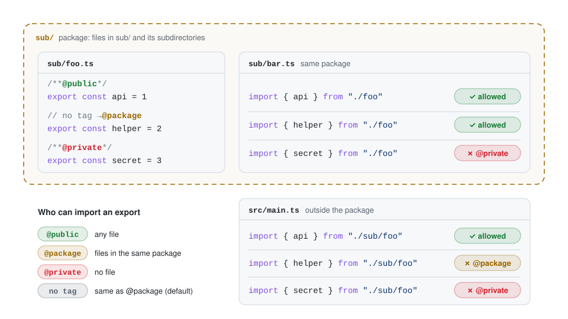

# @crutchcrew/oxlint-plugin-import-access 📦🔒

[](https://www.npmjs.com/package/@crutchcrew/oxlint-plugin-import-access)
[](https://github.com/crutchcrew/oxlint-plugin-import-access/actions)
[](https://www.npmjs.com/package/@crutchcrew/oxlint-plugin-import-access)
[](./LICENSE)

JSDoc import access for TypeScript, enforced by [oxlint](https://oxc.rs/docs/guide/usage/linter). Only `@public` exports can be imported from anywhere, and an export without an access tag is `@package`: only files in its own package (its directory and subdirectories) can import it. Tag an export `@public` to share it with the whole project, or `@private` so no other file can import it. To make untagged exports `@public` or `@private` instead, set [`defaultImportability`](#options).

A native oxlint JS plugin port of [eslint-plugin-import-access](https://github.com/uhyo/eslint-plugin-import-access) that needs **no type checker**: no `typescript` dependency, no `tsconfig.json` project loading, no typed linting setup.

## Access tags



Each export's JSDoc access tag decides which files can import it. A package is a directory with its subdirectories, and by default every directory is one (see [`packageDirectory`](./docs/rule-jsdoc.md#packagedirectory)). In the picture, `sub/foo.ts` has three exports:

- `api` is **`@public`**: any file can import it, `sub/bar.ts` as well as `src/main.ts`.
- `helper` has **no tag**, so it is `@package`: files in `sub/` and its subdirectories can import it, so `sub/bar.ts` can and `src/main.ts` can't.
- `secret` is **`@private`**: no file can import it, not even `sub/bar.ts` next to it.

Imports from Node.js builtins and from anything in `node_modules` are never checked.

## Why?

The largest encapsulation unit TypeScript gives you is a file. Once something is exported, the whole project can import it. Keeping things private means keeping them in one file, and files grow large.

This plugin adds a directory-level layer between a file and the whole project: an export stays inside its directory (`@package`) until you tag it `@public`. Tag what the rest of the project may use `@public`, and what no other file may use `@private`.

## Why this package

|                                        | This package | [eslint-plugin-import-access](https://github.com/uhyo/eslint-plugin-import-access) | [oxlint-plugin-import-access](https://github.com/bitkey-oss/oxlint-plugin-import-access) |
| -------------------------------------- | ------------ | ---------------------------------------------------------------------------------- | ---------------------------------------------------------------------------------------- |
| **Linter**                             | oxlint       | ESLint                                                                             | oxlint                                                                                   |
| **Needs type information**             | ❌           | ✅ typed linting                                                                   | ✅ TypeScript 7 unstable API                                                             |
| **`typescript` dependency**            | ❌           | ✅                                                                                 | ✅ `^7`                                                                                  |
| **Works without `tsconfig.json`**      | ✅           | ❌                                                                                 | ❌                                                                                       |
| **Checks unsaved edits in the editor** | ✅           | ✅                                                                                 | ❌ skipped until saved                                                                   |
| **Same results as the original rule**  | ✅ verified¹ | –                                                                                  | ✅                                                                                       |

¹ With `defaultImportability: "public"`, which makes exports without an access tag `@public` like in the original. This plugin's default is `"package"`.

## Install

Choose your fighter 🥊

```sh
pnpm add -D oxlint @crutchcrew/oxlint-plugin-import-access
```

```sh
bun add -D oxlint @crutchcrew/oxlint-plugin-import-access
```

```sh
yarn add -D oxlint @crutchcrew/oxlint-plugin-import-access
```

```sh
npm add -D oxlint @crutchcrew/oxlint-plugin-import-access
```

Requires Node.js `^20.19.0 || >=22.12.0` (the same as oxlint) and oxlint `>=1.40.0`.

## Configure

In **`.oxlintrc.json`**:

```json
{
	"jsPlugins": ["@crutchcrew/oxlint-plugin-import-access"],
	"rules": {
		"import-access/jsdoc": "error"
	}
}
```

Or in **`oxlint.config.ts`**:

```ts
import { defineConfig } from "oxlint"

export default defineConfig({
	jsPlugins: ["@crutchcrew/oxlint-plugin-import-access"],
	rules: {
		// Untagged exports are @package; tag an export @public to import it from anywhere
		"import-access/jsdoc": "error",
	},
})
```

That's all: there is no parser or project to configure. Diagnostics also show up in your editor through the [oxc extension](https://oxc.rs/docs/guide/usage/linter/editors) (oxlint's language server).

## Options

| Option                  | Default      | Description                                                                                |
| ----------------------- | ------------ | ------------------------------------------------------------------------------------------ |
| `indexLoophole`         | `true`       | `sub/index.ts` counts as `sub.ts`, so its package-private exports are visible one level up |
| `filenameLoophole`      | `false`      | `foo.ts` may import package-private exports from `foo/`                                    |
| `defaultImportability`  | `"package"`  | Access of exports without a tag: `"package"` (`@package`), `"public"` or `"private"`       |
| `treatSelfReferenceAs`  | `"external"` | Whether imports through your own package name are checked (`"internal"`) or not            |
| `excludeSourcePatterns` | `[]`         | Globs (relative to the working directory) of exporter files to skip, e.g. generated code   |
| `packageDirectory`      | every dir    | Globs of directories that are package boundaries, e.g. `["**", "!**/_internal"]`           |

All options and access tags (`@public`, `@package`, `@private`, `@access <level>`) behave as in the original plugin, except that `defaultImportability` defaults to `"package"` instead of `"public"`. See the **[rule documentation](./docs/rule-jsdoc.md)** for details and examples.

## How it works

The original rule asks the TypeScript type checker which declaration an import refers to. This plugin answers the same question from syntax alone:

1. resolve the import like TypeScript (`tsconfig` `paths`, `package.json` `exports`, `.js` → `.ts`) with [oxc-resolver](https://github.com/oxc-project/oxc-resolver),
2. skip builtins and anything reached through `node_modules`,
3. read the target file's exports and JSDoc with [oxc-parser](https://github.com/oxc-project/oxc/tree/main/napi/parser) — the module record and comments; the syntax tree only for the few files with decorators, `export =`, re-exported imports or JSDoc inside variable statements — and cache them,
4. follow `export *`, stop at direct re-exports like upstream, and read JSDoc with TypeScript's attachment and tag rules,
5. check ambient `declare module "…"` and wildcard `declare module "*.svg"` declarations too.

**Verified against the original:** the upstream test suite passes unchanged (same lines, columns, messages), and the port was compared with upstream's TypeScript-based rule on every fixture file and option combination, including new fixtures for re-export chains, overloads, enums, `export =`, wildcard modules and JSDoc placement, whose expectations in the test suite were generated by the original rule. The [known differences](./docs/rule-jsdoc.md#differences-from-upstream) are edge cases such as module augmentation across files.

## Performance

Generated project with nested feature directories, `export *` barrels and 6 imports per module (`bun run bench`), on an Apple M1 (8 cores, Asahi Linux), Node.js 26, oxlint 1.89:

| Modules (imports) | ESLint + eslint-plugin-import-access | oxlint + this plugin | Speedup |
| ----------------- | ------------------------------------ | -------------------- | ------- |
| 1,000 (6,000)     | 1.90 s                               | **0.31 s**           | 6.1×    |
| 2,500 (15,000)    | 4.89 s ¹                             | **0.55 s**           | 8.9×    |
| 5,000 (30,000)    | fails after 524 s ²                  | **0.95 s**           | –       |

ESLint 10 with typescript-eslint 8 typed linting (`projectService`), single run; oxlint best of 3. Both report identical diagnostics on every file the TypeScript-based rule can analyze. Of the 0.95 s, about 0.33 s is oxlint's own cost of running any JS plugin over 5,000 files.

¹ TypeScript fails on 16 of the 2,600 files ("Maximum call stack size exceeded"), so those files went unchecked.
² TypeScript fails on every file of this heavily cyclic project.

In a long-running editor session, files are re-checked as they change: exporter files are re-validated by size and modification time, and only re-parsed when they changed.

## Coming from eslint-plugin-import-access

1. Install oxlint and this package, and remove `eslint-plugin-import-access` from your ESLint config.
2. Move your rule options unchanged to `"import-access/jsdoc"` in the oxlint config. If you didn't set `defaultImportability`, set it to `"public"` to keep the original's behavior: here, untagged exports are `@package` by default.
3. For IDE auto-import filtering you can keep using the original package's [TypeScript language service plugin](https://github.com/uhyo/eslint-plugin-import-access/blob/master/docs/ts-server.md) (it only needs TypeScript, not ESLint); this package has no language service plugin of its own.

## Contributing

```sh
bun install
bun run test          # rule and unit tests (Node.js >= 22)
bun run build && bun run test:e2e
bun run check         # format, lint + typecheck (oxlint, with this plugin on its own sources), lockfile
```

## Credits

Based on [eslint-plugin-import-access](https://github.com/uhyo/eslint-plugin-import-access) by [uhyo](https://github.com/uhyo), whose rule design, options, documentation and test fixtures this port keeps.

## License

[MIT](./LICENSE)
